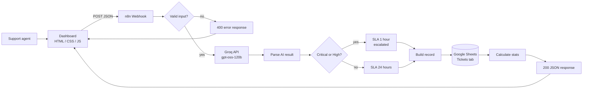
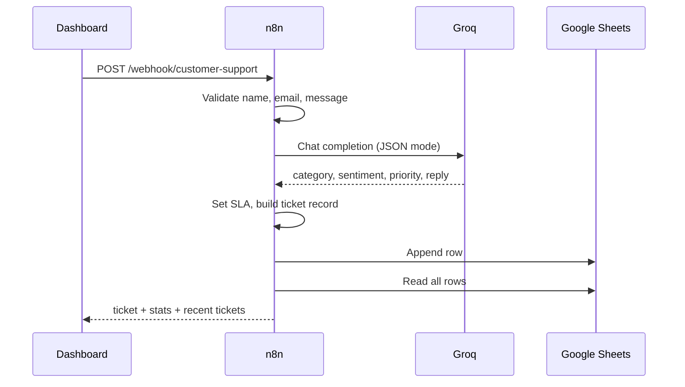

# AI-Business-Intelligence-Customer-Support-Automation
<div align="center">

# AI Customer Support & Business Intelligence

**Turn every customer message into a category, sentiment, priority, drafted reply and a saved record, in seconds.**


<!-- Repository badges: replace OWNER/REPO once with your GitHub path. Each badge then shows live data for your repo. -->

[](https://github.com/OWNER/REPO/stargazers)
[](https://github.com/OWNER/REPO/commits)
[](https://github.com/OWNER/REPO/issues)

</div>

---

## What it does

| Step | Result |
|---|---|
| A customer request is submitted in the dashboard | Sent to an n8n webhook |
| Input is validated | Bad requests get a clear error |
| Groq AI analyses the message | Category, sentiment, score, priority, summary |
| Priority sets the SLA | Critical and High get 1 hour, everything else 24 hours |
| A reply is drafted | Ready for an agent to send |
| Everything is saved | One new row in Google Sheets |
| Stats are recalculated | The dashboard updates charts and recent tickets |

## System design



### Request flow



## The 15 workflow nodes

| # | Node | Type | Job |
|---|---|---|---|
| 1 | Webhook | Webhook | Receives the POST request |
| 2 | Validate Input | Code | Cleans and checks the fields |
| 3 | Is Valid? | IF | Routes valid and invalid requests |
| 4 | Groq AI Analysis | HTTP Request | Calls the Groq chat completions API |
| 5 | Parse AI Result | Code | Reads the JSON, applies safe defaults |
| 6 | Is Urgent? | IF | Critical or High priority |
| 7 | Urgent SLA | Set | SLA 1 hour, escalated |
| 8 | Standard SLA | Set | SLA 24 hours |
| 9 | Join Paths | NoOp | Brings both branches together |
| 10 | Build Record | Code | Creates ticket ID, timestamp, final fields |
| 11 | Save to Google Sheets | Google Sheets | Appends the ticket |
| 12 | Read All Tickets | Google Sheets | Loads rows for analytics |
| 13 | Calculate Stats | Code | Totals and breakdowns |
| 14 | Respond Success | Respond to Webhook | Returns the result |
| 15 | Respond Error | Respond to Webhook | Returns a 400 with the reason |

## Requirements

- n8n 1.x, self-hosted or cloud
- A Groq account and API key from [console.groq.com](https://console.groq.com)
- A Google account with a Google Sheet and an OAuth connection in n8n
- Any modern browser for the dashboard
- No build step and no dependencies for the frontend

## Quick start

1. **Sheet.** Create a Google Sheet with a tab named `Tickets`. Import `google-sheet-template.csv` so row 1 holds the headers.
2. **Import.** In n8n choose *Import from file* and select `n8n-ai-support-workflow.json`.
3. **Groq credential.** Create a *Header Auth* credential:
   - Name: `Authorization`
   - Value: `Bearer gsk_your_key`
   - Rename the credential itself to "Groq API Key" (this label may contain spaces; the header name may not).
4. **Google credential.** Connect Google Sheets OAuth in nodes 11 and 12. Pick the same document and tab in both.
5. **Mapping.** In node 11 set *Mapping Column Mode* to **Map Automatically**.
6. **Activate** the workflow and copy the **Production** webhook URL.
7. **Dashboard.** Open `support-dashboard.html`, click *Webhook settings*, paste the URL and save.

## API

`POST /webhook/customer-support`

```json
{
  "customerName": "Alex Morgan",
  "email": "alex@example.com",
  "channel": "Website",
  "message": "I was charged twice for my subscription. Please help me."
}
```

Success (`200`) returns `success`, `ticket`, `stats` and `recent`. Failure (`400`) returns `{ "success": false, "error": "reason" }`.

## Sheet columns

`ticket_id, timestamp, name, email, message, category, sentiment, sentiment_score, priority, summary, ai_response, suggested_action, business_insight, sla, escalated, status`

Add `channel` as a column if you save it.

## Troubleshooting

| Message | Cause | Fix |
|---|---|---|
| `Header name must be a valid HTTP token` | Spaces in the credential's Name field | Set Name to `Authorization` |
| `model ... does not exist` | Model not available to your key | List models with `GET https://api.groq.com/openai/v1/models` and use an available id |
| `invalid syntax` in the body | Placeholder left in the expression | Paste the full body expression with no `...` |
| `At least one value has to be added under 'Values to Send'` | Manual mapping with empty fields | Use **Map Automatically** |
| Always the error branch | Node 3 checks a field node 2 does not output | Node 2 must output `valid` |
| Blank category and reply | AI output cut off | Raise `max_tokens`, or remove `response_format` |

## Project structure

```
.
├── README.md
├── n8n-ai-support-workflow.json
├── support-dashboard.html
└── google-sheet-template.csv
```

## Roadmap

- Email or Slack alert for escalated tickets
- Duplicate detection on repeated requests
- Weekly summary of top issues and sentiment trend
- Webhook secret and origin restriction

## Security notes

Keep API keys in n8n credentials, never in the workflow JSON or the dashboard. Restrict the webhook's allowed origin to your own domain before going live.
